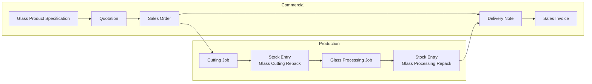
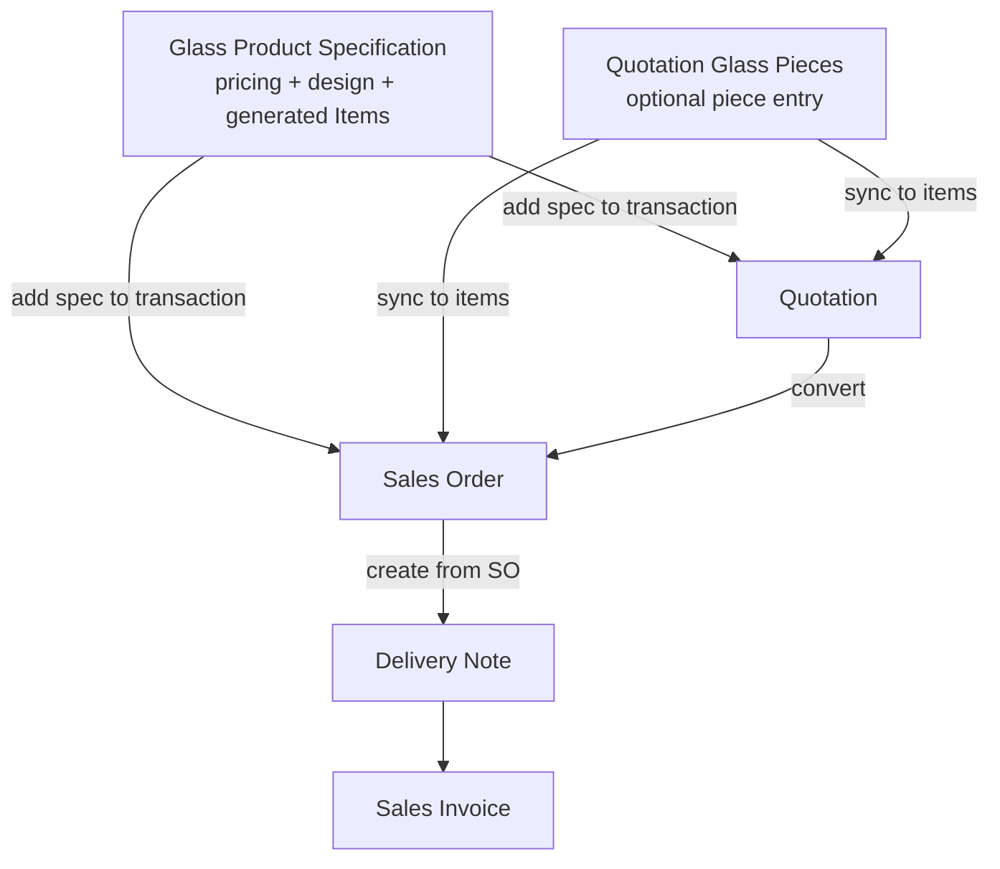
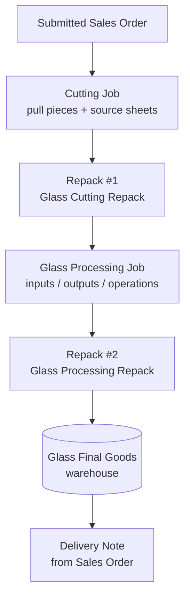
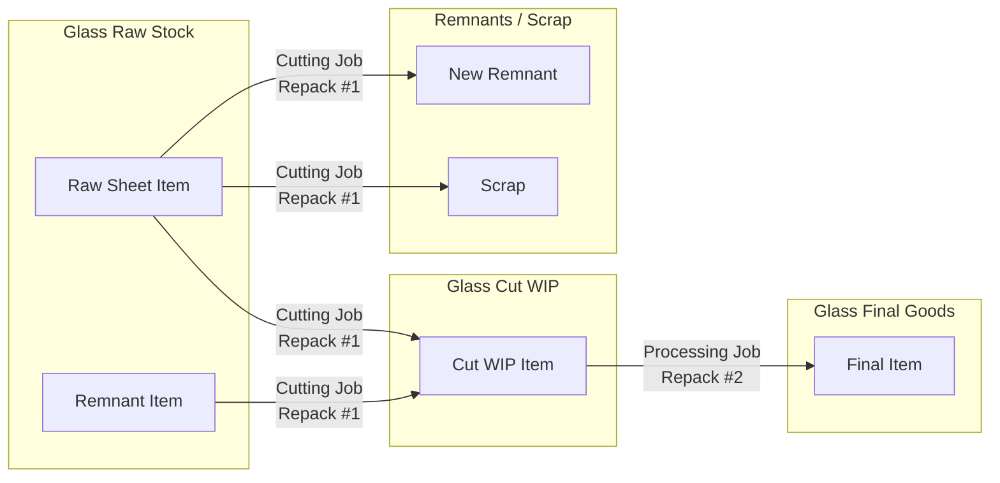

# Glass Factory

Frappe app for glass cutting, processing, pricing, and inventory on **ERPNext / Frappe v16**.

Phase 0 delivers a manual simple-glass MVP: sell exact finished-glass Items, cut and process them through dedicated jobs and Repack stock entries, without BOM, Work Order, Production Plan, or Job Card.

## Requirements

- Frappe Bench with ERPNext v16
- At least one **Company** before install (the setup wizard or a manual Company record)

## Installation

```bash
cd /path/to/frappe-bench
bench get-app glass_factory <repo-url>
bench --site <site> install-app glass_factory
bench --site <site> migrate
```

`after_install` seeds roles, custom fields, item groups, warehouses, default settings, operation rates, and glass-specific Stock Entry Types.

## Desk access

Open **Glass Factory** from the app switcher (`/app/glass-factory`) or the **Glass Factory** workspace.

## Flow diagrams

### End-to-end overview



The same **Final Item** created from the specification must appear on Quotation Item, Sales Order Item, Delivery Note Item, and Sales Invoice Item.

### Commercial flow



- **Glass Product Specification** is the technical and pricing source of truth: dimensions, operations, design files, generated Items, and per-piece rate.
- Specs can be added directly to Quotation or Sales Order; the same **final Item** must stay on every selling document row.
- Quotations can also use the **Glass Pieces** child table for piece-based entry before syncing to Items.
- Partial delivery uses standard ERPNext Sales Order / Delivery Note behaviour.

### Production flow



- **Cutting Job** groups one or more submitted Sales Orders, pulls glass pieces, records source sheets, and posts Repack #1.
- Repack #1 consumes **Raw Sheet** or **Remnant** stock and produces **Cut WIP**, **Remnant**, and **Scrap**.
- **Glass Processing Job** consumes Cut WIP and produces the exact **Final** Items from the Sales Order.
- Repack #2 moves finished glass into the final-goods warehouse. Optional processing-cost capitalization is controlled in settings.
- Delivery Notes must be created from the Sales Order and deliver the same final Item.

### Inventory and item transformation



## Core DocTypes

| DocType | Purpose |
|---|---|
| Glass Factory Settings | Warehouses, item groups, glass types, remnant rules, price lists, operation rates, COP toggle |
| Glass Product Specification | Spec, pricing, design attachments, and auto-generated Raw / Cut WIP / Final Items |
| Cutting Job | Manual cutting plan, source sheets, optional COP/optimizer data, Repack #1 |
| Glass Processing Job | Processing inputs/outputs/operations and Repack #2 |
| Quotation Glass Piece | Piece-level glass entry on Quotation / Sales Order |

Standard ERPNext documents are extended with glass metadata: **Item**, **Quotation**, **Sales Order**, **Delivery Note**, **Stock Entry**, and **Batch**.

## Item roles and naming

Glass stock Items use role-specific `GLS-*` codes. Dimensions and processing flags are encoded in the item code and mirrored on Item custom fields.

| Role | Example |
|---|---|
| Raw Sheet | `GLS-CLEAR-8MM-3210X2250` |
| Cut WIP | `GLS-CLEAR-8MM-1200X800-CUT` |
| Final | `GLS-CLEAR-8MM-1200X800-POL-HOL02-TMP` |
| Remnant | Derived from parent sheet dimensions |
| Scrap | Settings default scrap Item (e.g. `Glass Scrap`) |

Processing suffixes use stable operation codes, for example `POL`, `BEV`, `HOL02`, `TMP`, `SBL`, `LAM`.

Allowed glass types (e.g. `CLEAR`, `BRONZE`, `TINTED`) are configured in **Glass Factory Settings**.

## Warehouses and item groups

Install creates:

- **Warehouses:** Glass Raw Stock, Glass Cut WIP, Glass Final Goods, Glass Remnants, Glass Scrap
- **Item groups:** Glass Raw, Glass Cut WIP, Glass Final, Glass Remnants, Glass Scrap

Map these in **Glass Factory Settings** if your site uses different names.

## Pricing

- Operation default rates live in **Glass Factory Settings** and copy into each specification on first load.
- **Glass Product Specification** calculates raw cost, processing cost, selling rate per m², rate per piece, and margin.
- Minimum chargeable area and price-list fallbacks are settings-driven.
- Manual price overrides on specs and selling documents are tracked explicitly.

## Roles

| Role | Typical use |
|---|---|
| Glass Sales User | Quotations, Sales Orders, Delivery Notes, Sales Invoices |
| Glass Production Planner | Cutting Jobs, Processing Jobs |
| Glass Cutting Operator | Cutting execution and Repack #1 |
| Glass Processing Operator | Processing execution and Repack #2 |
| Glass Stock User | Stock Entries and inventory moves |
| Glass Manager | Full access including cancel/amend |

## Reports

| Report | Purpose |
|---|---|
| Glass Product Specification Summary | Spec status and pricing overview |
| Glass Production Progress Report | Order-to-production tracking |
| Glass Stock Traceability Report | Stock movement traceability by job / SO |
| Glass Cutting Yield and Waste Report | Cutting yield and waste analysis |
| Glass Processing Cost Report | Processing cost breakdown |
| Glass Costing and Margin Report | Costing and margin by spec / order |
| Remnant Inventory | Available remnant stock |
| Layout Visualizer | Cutting layout view (COP / manual pieces) |

## Stock Entry Types

- **Glass Cutting Repack** — Raw / Remnant → Cut WIP + Remnant + Scrap
- **Glass Processing Repack** — Cut WIP → Final (+ optional capitalized processing cost)

## Design attachments

Design files on a **Glass Product Specification** propagate to the generated Final Item and flow through Quotation, Sales Order, Cutting Job, and Processing Job updates.

## COP / optimizer

COP integration is **experimental and disabled by default** (`enable_cop` in settings). Phase 0 manual sheet and piece entry works without COP uploads or utilization approval.

## Exclusions (Phase 0)

- BOM, Work Order, Production Plan, Job Card
- Automated manufacturing workflows outside the manual Cutting / Processing Job path

## Development

Run the app test suite:

```bash
cd /path/to/frappe-bench
bench --site <site> run-tests --app glass_factory
```

Key modules:

- `item_resolver.py` — Item code generation and glass metadata
- `spec_pricing.py` / `piece_pricing.py` — Pricing engines
- `spec_transaction.py` — Spec → Quotation / Sales Order mapping
- `selling_validations.py` — Selling and delivery guards
- `stock_posting.py` — Repack stock entry builders

## License

MIT
